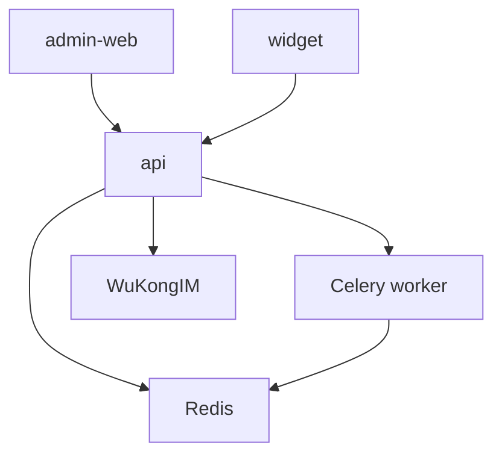

# MCSS Repository Instructions

MCSS (Multi-Agent Customer Support System) is a single-tenant customer-support application. This document provides instructions for agents working on this codebase.

## Work efficiently

1. Start with `git status --short`; do not disturb unrelated changes.
2. Identify the smallest affected service. Read its service-level instructions, then search that scope with `rg --files` and `rg -n` before reading limited code excerpts.
3. Reuse recent findings and successful relevant checks. Do not reread unchanged files or repeat searches, logs, tests, builds, downloads, web searches, or API calls without a reason.
4. Batch related searches, cap output to findings, and stop when evidence is sufficient. Avoid whole-repository scans, complete files/logs/dependency trees, speculative alternatives, and lengthy plans.
5. Do not install dependencies, rebuild containers, restart services, or start the stack unless the task requires it.

## Choose the lightest workflow

| Task | Required work |
| --- | --- |
| Trivial | Targeted edit plus syntax/format or local static validation. No broad audit, plan, service start, or full suite. |
| Focused | Trace the affected path in one service; run its focused test or static check. |
| Cross-service | Map producers/consumers and shared contracts first; read each affected service instruction and test the touched boundary. |
| Investigation-only | Inspect targeted evidence and report; do not implement. |
| High-risk | For migrations, auth, data, streaming, security, or external integrations, inspect contracts and run the relevant safety/functional checks. |

Do not make unrelated refactors. Do not write a long plan for trivial or focused work unless requested.

## Architecture

| Service | Directory | Role / port |
| --- | --- | --- |
| API | `api` | FastAPI core gateway, 8000; tests `tests/` |
| Admin Web | `admin-web` | React 19 admin console, 5173 |
| Widget | `widget` | React 18 widget bundle, 5174 |

Tech: Python 3.11, FastAPI, SQLAlchemy 2, Alembic, Pydantic v2, Redis, Celery, WuKongIM; React/TypeScript/Vite; PostgreSQL 16 + pgvector. Compose lives in `compose.yaml`; `scripts/` contains dev lifecycle scripts.

Read the applicable implementation phase under `local/MSCC-From-Scratch-docs/` before edits.

## Safety and compatibility

- Preserve HTTP, event/stream, database, and client contracts. Use owning-service clients; no cross-service direct database access.
- Fresh local PostgreSQL database and user are `mcss`. Keep `POSTGRES_*` and service `DATABASE_URL` values aligned. Credentials belong only in ignored `.env`/`.env.dev`; never print, commit, or report them.
- Never reset/delete databases, `data/`, Docker volumes, or user environments without explicit authorization. Inspect mounts/state before infrastructure changes; avoid `make clean`, `down -v`, and unnecessary rebuilds/restarts.
- Model/table changes require an Alembic migration committed with the code. Keep external URLs, secrets, package identities, and integrations in configuration.
- MCSS is the product identity. Preserve license, copyright, and attribution obligations.

## Verification and response

Run the smallest relevant check first. Expand only for shared interfaces or failures. For user-facing changes, verify the affected UI → API → service → database/tool path when practical. For data/config changes, verify loading, rendered Compose, migrations, and connections as applicable. Never claim checks that did not run; report important skips or blockers.

Default final response: 3–6 concise lines under **Changed**, **Verified**, and **Remaining**. Avoid routine progress narration and repeated summaries.
