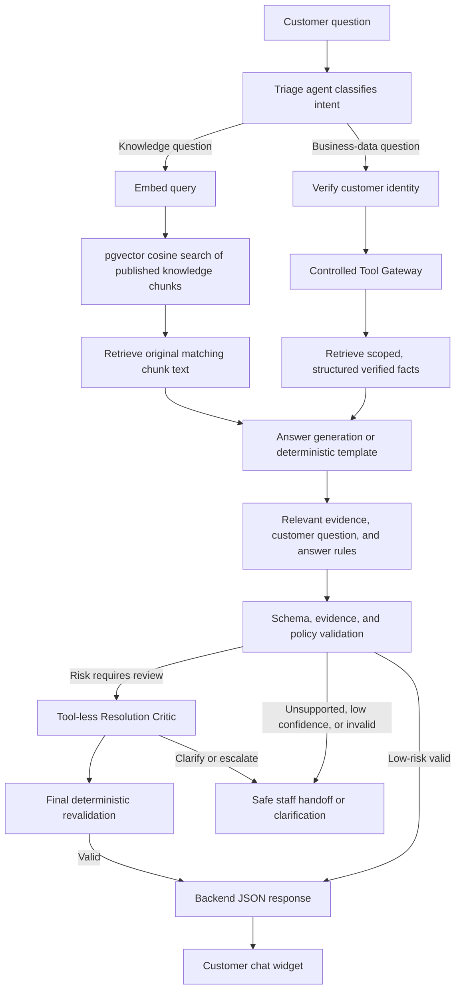

# MCSS Architecture

## Overview

MCSS (Multi-Agent Customer Support System) is a single-tenant customer support application consisting of three primary services:

1. **API** (FastAPI) - Core gateway handling authentication, conversations, knowledge base, and AI orchestration
2. **Admin Web** (React 19) - Staff console for managing conversations, documents, and settings
3. **Widget** (React 18) - Embeddable chat widget for website visitors

## System Diagram

```
┌─────────────────┐     ┌─────────────────┐
│  Visitor        │     │  Admin Staff    │
│  Browser        │     │  Browser        │
└────────┬────────┘     └────────┬────────┘
         │                       │
         ▼                       ▼
┌─────────────────────────────────────────┐
│           Widget Bundle (IIFE)          │
└────────┬────────────────────────────────┘
         │
         ▼
┌─────────────────────────────────────────┐
│              API (FastAPI)              │
│  ┌───────────────────────────────────┐  │
│  │  Auth Service                     │  │
│  │  Visitor Service                  │  │
│  │  Conversation Service             │  │
│  │  Knowledge Service                │  │
│  │  Assistant Service                │  │
│  │  Handoff Service                  │  │
│  │  Audit Service                    │  │
│  │  Providers (LLM/Embedding)        │  │
│  └───────────────────────────────────┘  │
└────────┬────────────────────────────────┘
         │
         ▼
┌─────────────────────────────────────────┐
│      PostgreSQL 16 + pgvector           │
└─────────────────────────────────────────┘
```

## Service Boundaries

### API Service (`api/`)
- Port: 8000
- Handles all business logic, authentication, database operations
- Provides REST API for admin web and widget
- Manages LLM and embedding provider integrations
- Runs database migrations on startup

### Admin Web (`admin-web/`)
- Port: 5173 (dev)
- React 19 + TypeScript + Vite + Tailwind
- Uses React Router and Zustand for client-side routing and state
- Routes: `/login`, `/inbox`, `/knowledge`, `/settings`, `/audit`

### Widget (`widget/`)
- Port: 5174 (dev)
- React 18 + TypeScript + Vite
- Builds as IIFE (`mcss-widget.js`) for embedding
- Mounts in Shadow DOM to avoid CSS conflicts
- Polls API every 3 seconds when visible

## Database

PostgreSQL 16 with pgvector extension for vector similarity search.

### Tables
- `users` - Staff/admin accounts with Argon2id password hashing
- `widget_settings` - Singleton row for widget configuration
- `visitors` - Anonymous visitor sessions
- `conversations` - Chat conversations with status tracking
- `messages` - Messages with metadata (sources, confidence, handoff reasons)
- `handoffs` - Human handoff queue
- `knowledge_documents` - Documents for knowledge base
- `knowledge_chunks` - Document chunks with vector embeddings
- `audit_events` - Immutable audit log

## Authentication

### Staff (Admin Web)
- Email/password → JWT access (15 min) + refresh (7 days) tokens
- Refresh token in HttpOnly cookie, access token in memory
- Role-based access: admin vs staff

### Visitor (Widget)
- Anonymous session via `POST /widget/sessions`
- Signed visitor JWT (24h) scoped to conversation
- Token in memory only, not localStorage

## Real-time Communication

WuKongIM provides real-time message delivery. PostgreSQL remains the durable source of truth; clients reconnect and re-fetch through the API when needed.

## LLM Integration

OpenAI-compatible Chat Completions API behind provider adapter:
- Production: real provider (OpenAI, Azure, etc.)
- Test/Fake: deterministic fake provider for CI
- Classification → Retrieval → Answer/Handoff pipeline
- Structured JSON output with validation

### How MCSS answers a customer question



Knowledge retrieval stores an embedding alongside the original text for each
knowledge chunk. The retrieved text—not a vector converted back into text—is
provided as context to answer generation. Business-data requests never permit
LLM-generated SQL or direct database access: the server-side Tool Gateway
enforces customer identity and data scope before returning verified facts.

For risk-based multi-agent resolutions, a deterministic backend policy may add
a JSON-only, tool-less reflection critic after initial validation. The critic is
advisory: approval never overrides citation or policy validation, and all high-
risk approval paths receive a final deterministic revalidation before response
delivery. Reflection receives only redacted structured findings and opaque
evidence references; it has no database, connector, or action authority.

### Feature-gated Phase 6 execution

When `MCSS_MULTI_AGENT_ORCHESTRATION_ENABLED=true`, the durable assistant-job
worker creates the server-owned tenant/conversation context and runs supervisor
planning, checkpointed specialist execution, evidence aggregation, deterministic
validation, and (when enabled by risk policy) reflection before it writes a
message. Every write is preceded by a fresh staff-takeover check. A disabled
flag retains the established single-pass assistant pipeline. Specialist tools are
fixed, server-authorized read-only capabilities; Phase 6 does not permit a
free-form model tool loop.

## Deployment

Docker Compose with:
- `postgres` - PostgreSQL 16 + pgvector (port 55432 host, 5432 internal)
- `api` - FastAPI with auto-reload in dev
- `admin-web` - Vite dev server
- `widget` - Vite dev server

Production adds Caddy reverse proxy for TLS and static file serving.
