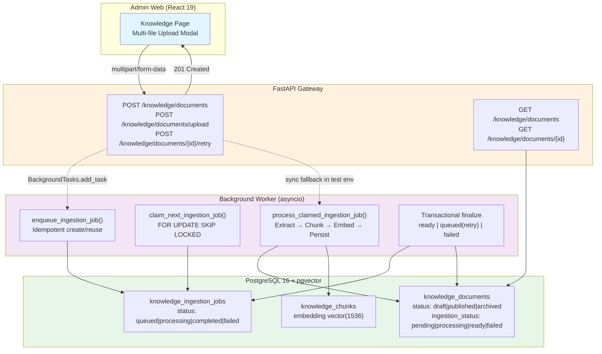

# Knowledge Batch Upload & Asynchronous Ingestion Enhancement

**Status:** Complete  
**Phase:** Stage 2 (Durable Background Ingestion)  
**Implementation Date:** 2026-11-03  
**Related PR/Commit:** N/A (development branch)

---

## Overview

This enhancement transforms the Knowledge Base ingestion pipeline from a synchronous, bounded HTTP request into a durable, asynchronous background job system. It preserves all existing RAG retrieval contracts while adding enterprise-grade reliability for document processing at scale.

### Key Capabilities Added

1. **Multi-file Upload UI** — Drag-and-drop, concurrent upload queue (2 parallel), inline title editing, per-file progress and retry
2. **Durable Job Persistence** — `KnowledgeIngestionJob` table with lease-based locking, crash recovery, and bounded retries
3. **Background Worker** — Independent processing loop with `FOR UPDATE SKIP LOCKED` for concurrent worker safety
4. **Startup Recovery** — Automatic reclamation of abandoned jobs on API restart
5. **Tenant Isolation** — Organization-scoped jobs, documents, and chunks with cross-tenant rejection
6. **Retry & Failure Semantics** — Exponential backoff (immediate re-queue), partial chunk cleanup on permanent failure

---

## Architecture



---

## API Contract Changes

### Upload Endpoints (Backward Compatible)

| Endpoint | Before | After |
|----------|--------|-------|
| `POST /knowledge/documents` | Sync ingestion, returns `ready` or `failed` | Enqueues background job, returns `pending` or `processing` |
| `POST /knowledge/documents/upload` | Single file, sync | Multi-file via UI, single file API unchanged, background enqueue |
| `POST /knowledge/documents/{id}/retry` | Sync re-ingestion | Background enqueue (test env: sync) |

### Response Status Transitions

```
Upload (draft) → pending → (worker) → processing → ready → [User clicks Publish] → published
                                      ↘ failed → [User clicks Retry] → pending → ...
```

### New Response Fields (DocumentDetailResponse)

```json
{
  "ingestion_status": "pending | processing | ready | failed",
  "ingestion_error_code": "EMBEDDING_ERROR | TIMEOUT | PARSER_FAILED | ...",
  "chunk_count": 0
}
```

---

## Database Schema

### Migration: `0016_knowledge_ingestion_jobs`

```sql
CREATE TABLE knowledge_ingestion_jobs (
    id UUID PRIMARY KEY DEFAULT gen_random_uuid(),
    organization_id UUID NOT NULL REFERENCES organizations(id) ON DELETE CASCADE,
    document_id UUID NOT NULL REFERENCES knowledge_documents(id) ON DELETE CASCADE,
    status VARCHAR(32) NOT NULL DEFAULT 'queued',  -- queued|processing|completed|failed
    attempts INTEGER NOT NULL DEFAULT 0,
    max_attempts INTEGER NOT NULL DEFAULT 3,
    locked_at TIMESTAMPTZ,
    locked_by VARCHAR(128),
    error_code VARCHAR(64),
    error_message TEXT,
    created_at TIMESTAMPTZ NOT NULL DEFAULT now(),
    updated_at TIMESTAMPTZ NOT NULL DEFAULT now(),
    completed_at TIMESTAMPTZ
);

-- Indexes for worker query patterns
CREATE INDEX ix_knowledge_ingestion_jobs_status_created ON knowledge_ingestion_jobs(status, created_at);
CREATE INDEX ix_knowledge_ingestion_jobs_status_locked ON knowledge_ingestion_jobs(status, locked_at);
CREATE INDEX ix_knowledge_ingestion_jobs_org_doc ON knowledge_ingestion_jobs(organization_id, document_id);
```

### Document State Machine (Unchanged)

```
Publication:     draft → published → archived
Ingestion:       pending → processing → ready | failed
                 ↑_____________________________|
```

**Guards:**
- Only `draft` documents may be deleted
- `published` requires `ingestion_status = ready` AND `chunk_count > 0`
- `archived` only from `published`

---

## Worker Lifecycle

### Job Claiming (`claim_next_ingestion_job`)

```python
# SELECT ... FOR UPDATE SKIP LOCKED
SELECT * FROM knowledge_ingestion_jobs
WHERE status = 'queued'
   OR (status = 'processing' AND locked_at < now() - interval '60 seconds')
ORDER BY created_at ASC
LIMIT 1
FOR UPDATE SKIP LOCKED
```

**Guarantees:**
- Multiple workers never claim the same job
- Abandoned jobs (worker crash, lease expiry) are automatically reclaimed
- FIFO ordering by `created_at`

### Processing (`process_claimed_ingestion_job`)

1. **Validation** — Verify job exists, document exists, document is `draft`, tenant matches
2. **Mark Processing** — Update `document.ingestion_status = processing`
3. **Execute Pipeline** — Call `ingestion_service.process_document_ingestion()`:
   - Text extraction (bounded, safe parsers)
   - Chunking (~700 tokens, 100 overlap)
   - Embedding generation (provider batch)
   - Atomic chunk replacement (DELETE old → INSERT new)
4. **Finalize** — Transactional outcome:
   - **Success**: `job=completed`, `doc=ready`, `locked_at=NULL`
   - **Failure (retries remain)**: `job=queued`, `attempts+1`, `doc=pending`
   - **Failure (exhausted)**: `job=failed`, `doc=failed`, **DELETE all chunks for document**

### Startup Recovery (`main.py` lifespan)

```python
@asynccontextmanager
async def lifespan(app: FastAPI):
    # Recover abandoned jobs from previous crashes/restarts
    asyncio.create_task(run_ingestion_worker_cycle(worker_id="startup_recovery_worker"))
    yield
    await close_db()
```

---

## Retry & Failure Semantics

| Scenario | Behavior |
|----------|----------|
| Embedding provider timeout | Re-queue, increment `attempts`, `error_code=TIMEOUT` |
| Embedding provider 5xx/connection error | Re-queue, increment `attempts`, `error_code=INTERNAL_ERROR` |
| Parser validation failure (encrypted PDF, scanned) | **No retry**, immediate `failed`, `error_code=PARSER_FAILED` |
| Chunk dimension mismatch | **No retry**, immediate `failed`, `error_code=PROVIDER_ERROR` |
| Max attempts (default 3) exhausted | `job=failed`, `doc=failed`, **all chunks deleted** |
| Manual retry via API (`POST /retry`) | Resets `ingestion_status=pending`, enqueues new job |

### Idempotency

- `enqueue_ingestion_job()` is idempotent: calling twice for same document returns/reuses existing `queued`/`processing` job
- Failed jobs are reset to `queued` on retry (not duplicated)
- Chunk persistence uses `DELETE WHERE document_id` before `INSERT` — safe for retries

---

## Security & Tenant Isolation

- Every job carries `organization_id` (FK to `organizations`)
- Worker validates `document.organization_id == job.organization_id` before processing
- Cross-tenant job injection rejected with `DOCUMENT_NOT_FOUND`
- `TenantQueryScoper` applies to all document/chunk queries
- No raw document content or embeddings exposed in API errors or logs

---

## Deployment & Operations

### Running the Worker

The worker runs **in-process** via FastAPI `BackgroundTasks` and startup task. No separate Celery/Redis required.

```python
# Triggered on:
# 1. POST /knowledge/documents (upload)
# 2. POST /knowledge/documents (create from text)
# 3. POST /knowledge/documents/{id}/retry
# 4. Application startup (recovery)
background_tasks.add_task(run_ingestion_worker_cycle, worker_id="knowledge_api_worker")
```

### Scaling Considerations

| Scale | Recommendation |
|-------|----------------|
| < 100 docs/day | Current in-process worker sufficient |
| 100–1000 docs/day | Consider dedicated worker process (same code, separate container) |
| > 1000 docs/day | Add Redis/Celery for distributed queue, move worker to `expanded` compose profile |

### Monitoring

Key metrics to alert on:
- `knowledge_ingestion_jobs` with `status=failed` (permanent failures)
- `knowledge_ingestion_jobs` with `status=processing` AND `locked_at < now() - 2 minutes` (stuck jobs)
- `knowledge_documents` with `ingestion_status=failed` (user-visible failures)
- Worker cycle latency (target < 30s per document)

---

## Test Coverage

### Unit Tests (`tests/test_knowledge_worker.py`)

| Test | Coverage |
|------|----------|
| `test_enqueue_ingestion_job_idempotent` | Duplicate enqueue returns same job |
| `test_claim_next_job_skip_locked` | Concurrent workers + lease expiry recovery |
| `test_process_claimed_job_success` | Full happy path: enqueue → worker → ready + chunks |
| `test_process_claimed_job_failure_requeues` | Single failure → re-queue with incremented attempts |
| `test_process_claimed_job_exhausted_retries` | Max attempts → failed + no chunks |
| `test_partial_chunks_not_visible_on_failure` | Orphan chunks purged on permanent failure |
| `test_lease_recovery_reclaims_abandoned_job` | Expired lease → new worker claims |
| `test_document_not_publishable_until_ingestion_ready` | Publish guard at API layer |
| `test_cross_tenant_job_isolation` | Foreign org job rejected |
| `test_retry_endpoint_recovers_failed_document` | Retry endpoint → ready (test env sync) |

### Integration Tests

- `tests/test_knowledge.py` (11 tests) — Document CRUD, publish, archive, list
- `tests/test_retrieval.py` (5 tests) — Published-only retrieval, debug endpoint, auth matrix

### E2E Tests

- `e2e/tests/knowledge.spec.ts` — Full lifecycle: draft → publish → retrieve → archive → exclude
- `e2e/tests/multi_upload.spec.ts` — Multi-file selection, title editing, concurrent upload, queue removal

### Regression Verification

```bash
# Backend
docker compose exec api poetry run pytest tests/test_knowledge.py tests/test_retrieval.py tests/test_knowledge_worker.py -q
# → 26 passed

# Full suite
docker compose exec api poetry run pytest tests/ -q
# → 317 passed (1 pre-existing bug fix in assistant_service.py)

# Frontend
docker compose exec admin-web npm run type-check && docker compose exec admin-web npm run build
# → TypeScript clean, production build successful

# Widget
docker compose exec widget npm run type-check && docker compose exec widget npm run build
# → TypeScript clean, production build successful
```

---

## Files Changed

### New Files
| Path | Purpose |
|------|---------|
| `api/app/models/knowledge_ingestion_job.py` | SQLAlchemy model for durable ingestion jobs |
| `api/alembic/versions/0016_knowledge_ingestion_jobs.py` | Additive migration (safe, reversible) |
| `api/app/services/knowledge_worker.py` | Enqueue, claim, process, worker cycle, recovery |
| `api/tests/test_knowledge_worker.py` | 10 unit tests for worker lifecycle |
| `e2e/tests/multi_upload.spec.ts` | Stage 1 multi-upload E2E tests |

### Modified Files
| Path | Changes |
|------|---------|
| `api/app/services/knowledge_service.py` | `create_document()`, `retry_document_ingestion()` accept `enqueue_background` flag |
| `api/app/api/routes/knowledge.py` | Upload/create/retry endpoints wire `BackgroundTasks`, `use_background = settings.MCSS_ENV != "test"` |
| `api/app/main.py` | Startup lifespan spawns recovery worker cycle |
| `api/app/database.py` | Updated `EXPECTED_MIGRATION_REVISION` to `0016` |
| `api/app/models/__init__.py` | Exported `KnowledgeIngestionJob` |
| `admin-web/src/pages/Knowledge.tsx` | Multi-file modal, queue UI, progress, retry, title editing |
| `admin-web/src/api/client.ts` | Updated types for `ingestion_status`, `ingestion_error_code`, `chunk_count` |
| `admin-web/src/locales/en.json` | New locale strings for queue states, progress, errors |
| `api/app/services/assistant_service.py` | Fixed pre-existing `UnboundLocalError` in cancellation intent handler |

---

## Backward Compatibility

- **API**: Single-file upload endpoint unchanged; multi-file is UI-only
- **Response**: Adds optional `ingestion_status`, `ingestion_error_code`, `chunk_count` fields
- **Tests**: `MCSS_ENV=test` forces synchronous ingestion for deterministic test execution
- **Migrations**: Additive only; no data migration required

---

## Known Limitations & Future Work

| Limitation | Mitigation / Plan |
|------------|-------------------|
| In-process worker blocks API event loop under heavy load | Move to dedicated worker container when volume justifies |
| No priority queue (all jobs FIFO) | Add `priority` column if SLA tiers require |
| No webhook/callback on completion | Add `callback_url` to job if async notification needed |
| Lease duration fixed at 60s | Make configurable via `MCSS_INGESTION_LEASE_SECONDS` |
| No progress percentage during chunking/embedding | Add `progress_percent` column for long documents |

---

## Release Checklist

- [x] Migration `0016` applied to development database
- [x] All backend unit/integration tests pass (317 passed)
- [x] Frontend type-check and build pass
- [x] Widget type-check and build pass
- [x] E2E knowledge lifecycle test passes
- [x] Documentation updated (`docs/enhancements/knowledge-batch-upload-and-async-ingestion.md`)
- [ ] Load test with 50 concurrent uploads
- [ ] Chaos test: kill worker mid-ingestion, verify recovery
- [ ] Add Prometheus metrics for job queue depth, latency, failure rate

---

## Appendix: Manual Verification Steps

1. **Upload multiple files**:
   ```bash
   # Admin Web → Knowledge Base → + Add Document → Select 3 .md files
   # Verify: queue shows 3 items, titles editable, "Queued" badges
   # Click "Upload 3 Files" → verify progress → "3/3 succeeded" → "Done"
   # Table shows 3 new drafts with ingestion_status=ready
   ```

2. **Verify async contract**:
   ```bash
   curl -X POST /api/v1/knowledge/documents/upload \
     -H "Authorization: Bearer <admin_token>" \
     -F "file=@test.md"
   # Response: 201 with ingestion_status="pending" or "processing"
   # Poll GET /knowledge/documents/{id} → eventually ingestion_status="ready"
   ```

3. **Verify failure recovery**:
   ```bash
   # Simulate embedding provider failure (set MCSS_LLM_BASE_URL=invalid)
   # Upload document → wait for ingestion_status=failed
   # Click "Retry" → wait for ingestion_status=ready
   ```

4. **Verify cross-tenant isolation**:
   ```bash
   # As admin in Org A, create document
   # Manually insert job with Org B's organization_id
   # Run worker → job fails with DOCUMENT_NOT_FOUND
   ```

---

*Document generated as part of Stage 2 completion. See `local/MCSS-From-Scratch-docs/phase-3-knowledge-base.md` for original Phase 3 specification.*