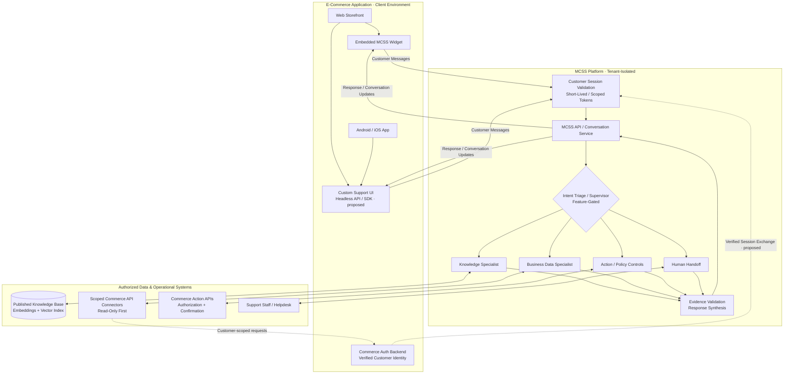

# MCSS Client Integration Guide — E-Commerce Applications

**Document status:** Proposed integration contract and implementation guide  
**Audience:** E-commerce platform engineers, MCSS integration engineers, security teams, and support administrators  
**Scope:** Integrating an existing e-commerce website or mobile application with the Multi-Agent Customer Support System (MCSS)  
**Last updated:** 2026-11-04

> **Implementation note:** This guide describes the desired enterprise integration experience. The current MCSS codebase has a web widget, FastAPI backend, tenant-aware knowledge retrieval, customer conversations, business-data tools, and feature-gated multi-agent orchestration. Public SDK package names, routes, token-exchange flows, webhook formats, and connector contracts shown as *illustrative* below must not be treated as implemented or stable until they are verified against the repository and published API specification. In particular, the Phase 6 multi-agent workflow may be disabled at runtime.

## 1. Purpose

MCSS lets an e-commerce business add customer support to its existing website and applications **without replacing the commerce backend**. The commerce company remains the system of record for customer identity, orders, shipments, payments, returns, refunds, and other business data. MCSS supplies a customer-facing support interface, conversation handling, relevant knowledge retrieval, authorized tool access, and coordinated agent responses.

Integration should be possible in two modes:

1. **Embedded experience:** An MCSS-hosted or packaged chat widget appears inside the client's website or application.
2. **Headless integration:** The client builds its own user interface and connects to MCSS through versioned APIs or a supported SDK.

The platform must maintain tenant isolation and enforce authentication, authorization, policy checks, and auditability for every customer-specific operation.

## 2. Reference architecture

The diagram below shows the **target integration architecture** and the trust boundaries between the e-commerce application, MCSS, and commerce-owned systems. Some interfaces (such as public mobile SDKs and a dedicated session-exchange endpoint) are **proposed contracts**, not verified shipped features. The Supervisor is feature-gated; when disabled, the runtime uses the legacy assistant pipeline.



**Flow:** The customer opens support inside the e-commerce app → MCSS validates the customer session → the active routing pipeline selects relevant specialists → each specialist uses authorized knowledge or commerce systems → MCSS validates evidence and returns one grounded response. Business actions require separate authorization and confirmation. Human escalation is used when needed. Arrows illustrate logical communication rather than prescribed network protocols.

### Separation of responsibilities

| Component | Responsibility |
|---|---|
| E-commerce frontend | Present support entry point and customer UI; never embed MCSS client secrets. |
| E-commerce backend | Authenticate customers, authorize access to business records, expose approved APIs, execute approved business actions. |
| MCSS API | Accept scoped sessions and messages, maintain conversations, enforce tenant boundaries. |
| Knowledge system | Index and retrieve approved, **published** support documentation using semantic embeddings. |
| Business-data connector | Read narrowly scoped customer-specific facts from authorized e-commerce APIs. |
| Supervisor and specialists | Route single- and multi-intent requests; use evidence rather than relying only on keywords. |
| Action-policy layer | Require server-side authorization, confirmation, idempotency, and applicable approvals before changing state. |
| Support team | Receive escalations with appropriate context and access controls. |

## 3. Integration prerequisites

Before launching, the e-commerce company and MCSS operator should agree on:

- **Organization and environments:** Separate MCSS tenant/environment identifiers for development, staging, and production; documented ownership of configuration and secrets.
- **Customer identity:** A secure backend-mediated session exchange or equivalent verified identity integration; token lifetime, refresh, logout, and revocation requirements.
- **Business-data interfaces:** Which APIs are available for order details, fulfillment, shipment events, payments, returns, and refunds; how ownership is checked.
- **Knowledge sources:** Published FAQs, shipping and return policies, cancellation rules, contact information, and operational limitations.
- **Allowed actions:** Whether MCSS can only answer questions or can also request cancellation, returns, refunds, or other state changes.
- **Service operations:** Availability targets, rate limits, support ownership, logging, data retention, compliance obligations, and escalation procedures.

Do not use production customer records or credentials for development testing unless expressly authorized and appropriately protected.

## 4. Client onboarding workflow

### Step 1 — Provision an MCSS organization

Create the organization's tenant, grant only the required staff roles, and configure branding, allowed domains/origins, language, environment endpoints, and relevant security policies. Verify that data from another organization cannot be accessed.

### Step 2 — Configure customer identity and sessions

The e-commerce app continues using its existing login system. Its trusted backend validates the logged-in customer and obtains or issues an MCSS-compatible, short-lived customer session through a **verified integration contract**. The session must bind the customer to the correct MCSS organization and carry only necessary identity and scope claims.

The browser or mobile app must never receive a long-lived connector secret, API master key, or administrative token.

### Step 3 — Connect authorized commerce APIs

Configure read-only integrations first. Typical operations include:

| Customer intent | Minimum authorized capability | Example backend evidence |
|---|---|---|
| “Where is my order?” | Read an identified customer's order and shipment state | Order status, tracking timestamp, carrier status |
| “Show my recent orders.” | List the authenticated customer's orders | Recent order IDs, summaries, statuses |
| “Why was my payment declined?” | Read permitted transaction status | Payment status and non-sensitive failure code |
| “What is the return policy?” | Retrieve published knowledge | Published returns-policy section |
| “Cancel this order.” | Check eligibility, gather confirmation, and execute permitted action | Eligibility decision, confirmation, action result |

**Authorization rule:** An MCSS-issued session does not replace the e-commerce backend's authorization check. Every customer-data lookup and state-changing request must be constrained to the authenticated customer, organization, and explicitly permitted operation. Avoid accepting arbitrary customer IDs from untrusted client input as proof of ownership.

### Step 4 — Publish the knowledge base

Upload and review product-independent support information, including order status definitions, shipping timelines, cancellation rules, refund processing, account guidance, and support limitations. Documents should be approved and published before retrieval. Use a genuine **semantic embedding provider** consistently for both document indexing and customer queries; a fake or random-vector provider is unsuitable for relevance testing or production knowledge retrieval.

If the embedding model changes, plan a controlled, tenant-scoped re-embedding process with backup and rollback. Do not automatically delete, re-upload, or republish customer documents as part of integration.

### Step 5 — Add the support entry point

Integrate the MCSS widget on the web or use a supported mobile SDK/headless API. Open the chat from the application's existing “Help & Support” location, and preserve conversation continuity where authorized.

### Step 6 — Configure policies and handoffs

Set action permissions, escalation conditions, unavailable-data responses, business hours (if relevant), staff access, and audit requirements. Test refusals and confirmation flows—not only successful answers.

### Step 7 — Validate in staging and roll out

Run the acceptance tests in Section 11, review security findings, enable only verified capabilities, and roll out gradually with monitoring and a rollback plan.

## 5. Frontend integration patterns

### 5.1 Embedded web widget

A published MCSS web widget could expose an interface similar to the following. **This is an example of a future integration contract, not an assertion that this package currently exists.**

```javascript
// Illustrative SDK only — confirm the actual package/API before implementation.
import { MCSS } from "@mcss/web-sdk";

const customerSessionToken = await fetch("/support/mcss-session", {
  method: "POST",
  credentials: "include",
}).then(async (response) => {
  if (!response.ok) throw new Error("Unable to initialize support session");
  return (await response.json()).sessionToken;
});

MCSS.init({
  organizationId: "<public-organization-identifier>",
  sessionToken: customerSessionToken,
  theme: { primaryColor: "<brand-color>" },
});

MCSS.open();
```

The `/support/mcss-session` endpoint in this sample belongs to the **e-commerce application backend**, not necessarily to MCSS. The frontend calls it using the customer's existing authenticated session. The trusted backend then follows the agreed MCSS identity integration process.

Required widget behavior includes responsive display, loading and error states, safe session refresh, accessible controls, reconnection/retry handling, and optional conversation resume subject to policy.

### 5.2 Android and iOS applications

Two options should be supported as product capabilities mature:

- **Native SDK:** A first-party or supported SDK with authentication hooks, conversation UI components, lifecycle handling, and reliable message delivery.
- **Headless API:** The commerce application renders a native chat screen and connects to a documented MCSS API. This is best for deeply customized experiences.

A web-based fallback may be feasible for early integrations but is not a substitute for validating mobile login, session storage, push/foreground behavior, accessibility, and platform security.

### 5.3 Headless API

A future stable API should cover session initialization, conversation creation/resume, message submission, streaming or asynchronous responses, event handling, and escalation state. Publish exact schemas, error codes, authentication requirements, idempotency behavior, pagination, and versioning in [`api.md`](api.md). Do not rely on guessed routes or payloads from this guide.

## 6. Secure identity flow

```text
1. Customer logs into the e-commerce application.
2. Customer opens Help & Support.
3. E-commerce frontend calls its own authenticated backend.
4. E-commerce backend verifies identity and obtains a scoped MCSS session.
5. Frontend opens the MCSS widget or API session with that short-lived token.
6. MCSS validates issuer, audience, expiry, tenant, customer binding, and scopes.
7. Every business-data operation is independently checked for authorization.
8. On logout, expiry, or revocation, the client stops using the session.
```

**Security requirements:** Enforce HTTPS; validate tokens server-side; use strict origin controls where applicable; implement token expiry and rotation; protect connector credentials in server-side secret storage; apply least privilege, rate limits, audit logging, and data minimization. Avoid sending sensitive payment-card details, passwords, or unneeded personal data through LLM prompts or logs.

## 7. Business-data connector design

The e-commerce platform should expose or approve a narrowly scoped adapter rather than granting MCSS unrestricted database access. The adapter should enforce tenant and customer ownership on every request and return the minimum fields required for an answer.

**Illustrative interface (not an existing verified MCSS endpoint):**

```text
get_order(customer_context, order_id)
list_orders(customer_context, limit, cursor)
get_shipment(customer_context, order_id)
get_payment_status(customer_context, order_id)
get_return_eligibility(customer_context, order_id)
```

An operation such as `list_orders` must run only when the user explicitly requests an order list or when a carefully justified disambiguation flow requires a bounded choice. It must not be an automatic fallback for any message containing the words “my order” or “parcel.”

A shipping API that does not expose parcel hub locations cannot justify a precise hub-location answer. The assistant must acknowledge missing information and offer the relevant supported next step.

For state-changing operations, add a separate allowlisted contract with policy evaluation, explicit confirmation, request idempotency, audit evidence, and safe failure handling. Do not let generated text directly perform arbitrary backend actions.

## 8. Expected customer-facing behavior

MCSS must answer the *question asked*, drawing on published knowledge and authorized evidence. Route by intent and conversation context, not isolated keywords.

| Example customer message | Expected handling |
|---|---|
| “How can I check when my order was approved?” | Knowledge/process guidance from the published KB; no unrelated order list. |
| “What does ‘approved’ mean?” | Explain the documented order-status meaning with a source reference. |
| “Show my recent orders.” | Authenticate and obtain the customer's permitted order list. |
| “When was my order approved?” | Identify the relevant order; query its authorized status history or clarify which order. |
| “Is my order approved, and what does approved mean?” | Combine authorized account data and published knowledge into one answer. |
| “Which hub has my parcel?” | Check supported shipment evidence if appropriately identified; if hub data is unavailable, say so. |
| “Cancel my order.” | Verify eligibility and require confirmation/approval before any allowed mutation. |

When evidence is insufficient, MCSS should ask a focused clarifying question, explain a capability limitation, or offer staff escalation. It must not fabricate policies, delivery dates, refund outcomes, hub locations, or completed actions.

### Legacy versus multi-agent mode

MCSS has a legacy assistant route and a feature-gated multi-agent route. Before an integration goes live, confirm which is active in the actual runtime. The acceptance criteria apply to **both** paths. Enabling orchestration or reflection flags is a deployment decision that requires integration tests; the presence of code does not prove an enabled or production-ready workflow.

## 9. Deployment and operations

- Use separate configuration and credentials for each environment and tenant.
- Publish health, readiness, integration failure, and latency signals. Differentiate provider errors, missing knowledge, failed authentication, and connector outages.
- Rate-limit requests at appropriate boundaries and set realistic timeouts and retry budgets; prevent duplicate or unauthorized state-changing requests.
- Preserve conversations and evidence according to documented retention, deletion, export, and compliance policies.
- Provide support teams with controlled escalation context, not unrestricted access to a customer's entire account.
- Document incident response, rollback, key rotation, and recovery procedures in [`runbook.md`](runbook.md).

## 10. Integration readiness checklist

- [ ] Tenant created with correct environment configuration and staff access.
- [ ] Web or mobile support entry point integrated and branded.
- [ ] Trusted customer session creation, expiry, refresh, logout, and revocation tested.
- [ ] Business-data connectors verified for least privilege and customer ownership.
- [ ] Approved KB content published and indexed using consistent semantic embeddings.
- [ ] Knowledge, customer-record, multi-intent, and unsupported-data responses verified.
- [ ] State-changing operations require validated policy checks and explicit confirmation.
- [ ] Human handoff, audit logging, availability, rate limits, and error handling tested.
- [ ] Tenant-isolation, authentication, and abuse tests pass.
- [ ] Runtime flags and selected orchestration pipeline documented.
- [ ] Production roll-out and rollback plan approved.

## 11. Acceptance tests

The minimum integration test suite should include:

1. **Knowledge relevance:** A general question retrieves the expected published document and provides a grounded response; measure top-1/top-5 retrieval quality with a known evaluation set.
2. **Private records:** An authenticated customer can retrieve only their own permitted orders and shipments.
3. **Cross-customer denial:** Attempted access to another customer's order is rejected at the connector/backend boundary.
4. **No blind listing:** A question about a parcel's hub does not dump all recent orders.
5. **Mixed intents:** A question combining actual status and status meaning uses both authorized data and published policy.
6. **Unknown facts:** Missing hub/tracking/refund evidence produces an accurate limitation, not fabricated information.
7. **Action safety:** Cancellation or refund requests require the correct eligibility, confirmation, authorization, and idempotency checks.
8. **Degraded services:** Embedding or connector outages trigger controlled responses and observable errors without leaking credentials or other tenants' data.
9. **Session boundaries:** Expired, revoked, invalid-audience, or wrong-tenant tokens are rejected.
10. **Runtime compatibility:** Tests pass for the currently enabled pipeline; a feature-gated multi-agent path is tested independently before activation.

## 12. Capability status and implementation verification

The table below separates **known architectural foundations** from **integration capabilities to confirm or build**. It is not a substitute for a current repository audit.

| Capability | Status for this guide |
|---|---|
| FastAPI backend and web-based admin/widget | Existing architectural foundation; verify deployment-specific API contracts. |
| Tenant-scoped knowledge documents and retrieval | Existing architectural foundation; verify indexing provider and runtime health. |
| Customer conversations and business-data tooling | Existing architectural foundation; verify authentication and connector scopes. |
| Supervisor and specialist agents | Implemented in code, but runtime activation is feature gated. |
| Published public JavaScript/mobile SDK contract | **Proposed — not verified as available.** |
| Dedicated client session-exchange API | **Proposed — actual contract must be verified/designed.** |
| Stable, versioned headless public API | **To confirm and document.** |
| Generic connector self-service onboarding and webhooks | **Proposed — implementation status unverified.** |
| Production-grade rollout, SLOs, and compliance controls | **Requires environment-specific validation.** |

## 13. Related documentation

- [`architecture.md`](architecture.md) — Internal MCSS architecture and agent/data flow.
- [`api.md`](api.md) — Exact implemented API contracts and authentication requirements.
- [`threat-model.md`](threat-model.md) — Security assumptions, abuse cases, and tenant boundaries.
- [`runbook.md`](runbook.md) — Deployment, operations, incident handling, and recovery.
- [`decisions.md`](decisions.md) — Architectural decisions and trade-offs.
- [`enhancements/knowledge-batch-upload-and-async-ingestion.md`](enhancements/knowledge-batch-upload-and-async-ingestion.md) — Knowledge ingestion enhancement design.

---

**Success criterion:** An e-commerce customer can open support inside the existing app, ask a natural-language question, and receive a relevant, evidence-grounded response drawn from published knowledge and/or their own authorized business records—without replacing the commerce backend, leaking private data, or executing unapproved actions.
